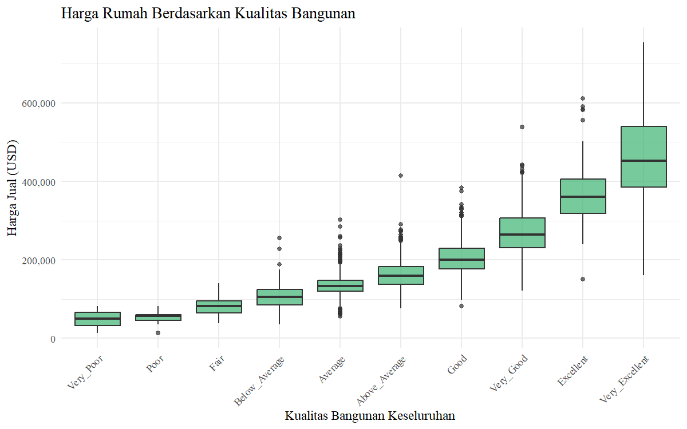
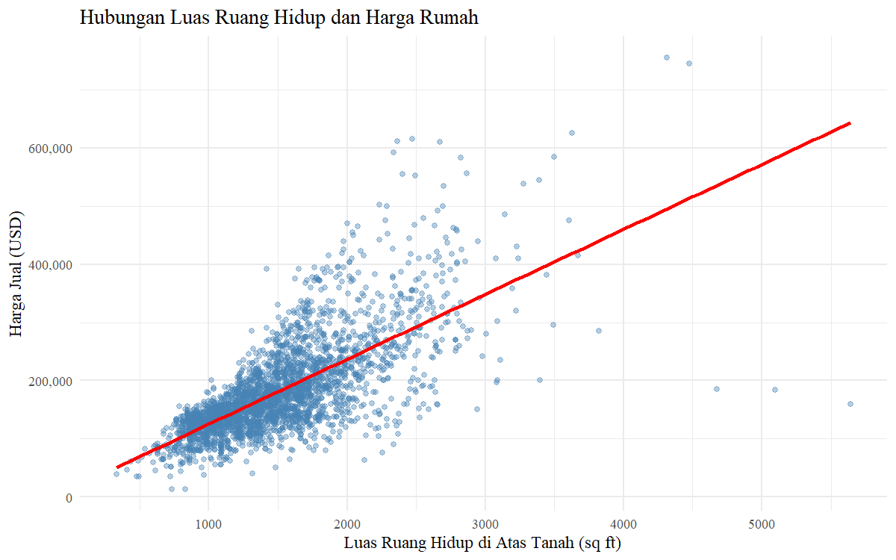
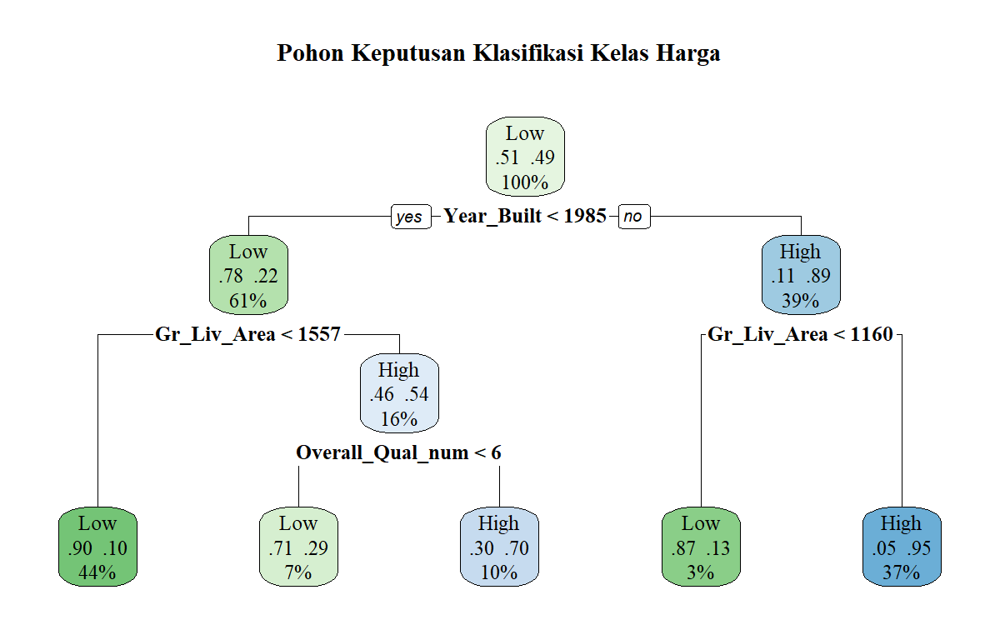
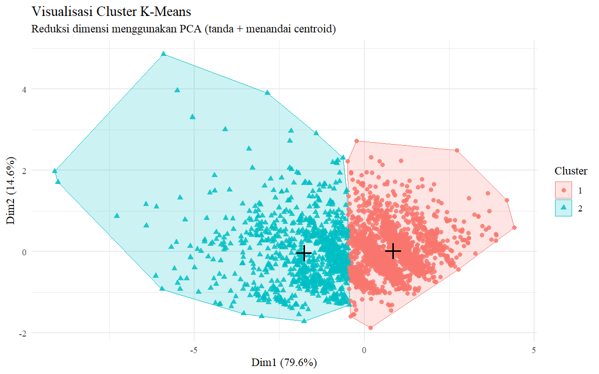

# Ames Housing Price Analysis

Regression, classification, and segmentation of 2,930 residential property sales in Ames, Iowa, built in R and structured around the CRISP-DM process (Business Understanding through Evaluation).

**Full report:** [PDF](reports/ames_housing_analysis.pdf) | [HTML](reports/ames_housing_analysis.html) (download to view; code blocks are foldable). The report is written in Indonesian.

## Results at a Glance

All metrics are computed on a 20% hold-out test set (n = 586).

| Task | Model | Result |
| --- | --- | --- |
| Price prediction | Multiple linear regression, 9 numeric predictors | R² 0.799, RMSE USD 34,464, MAE USD 23,088 |
| Price prediction baseline | Training-set mean | RMSE USD 77,451 |
| High/Low price class (split at median, USD 160,000) | Decision tree (`rpart`) | Accuracy 0.894, Precision 0.948, Recall 0.854, F1 0.898 |
| Property segmentation | K-Means, k = 2 | Average silhouette 0.462, BSS/TSS 0.501 |

## Problem Statement

Setting a sale price is uncertain for sellers, buyers, and agents: overpricing slows a sale, underpricing loses money. This project asks which property characteristics are most strongly associated with sale price in Ames, how accurately a simple and interpretable model can estimate price, and whether homes fall into distinct segments.

## Objectives

1. Predict `Sale_Price` with a regression model and identify its strongest predictors.
2. Classify homes as above or below the median price.
3. Group properties with similar price, size, and quality.

## Dataset

- **Source:** `make_ames()` from the [AmesHousing](https://cran.r-project.org/package=AmesHousing) R package (v0.0.4), based on De Cock, D. (2011), "Ames, Iowa: Alternative to the Boston Housing Data as an End of Semester Regression Project", *Journal of Statistics Education*, 19(3).
- **Size:** 2,930 sales recorded from 2006 to 2010, 81 numeric and categorical variables.
- **Storage:** no data files are kept in this repository. The data loads directly from the package.
- **Note:** `make_ames()` contains no `NA` values because it recodes missing values, for example as `0` (490 values of `Lot_Frontage`, 23 of `Mas_Vnr_Area`) or as categories such as `No_Garage`. The report documents this.

## Methodology

1. **Data understanding:** price distribution and outliers, correlation of numeric variables with price, price by living area and by overall quality.
2. **Data preparation:** missing-value, duplicate, range, and cross-variable consistency checks; ordinal encoding of `Overall_Qual` (1 to 10); selection of the 10 numeric variables most correlated with price, minus `Garage_Area` (r = 0.89 with `Garage_Cars`); z-score scaling for clustering; random 80/20 train-test split (seed 123).
3. **Modeling:**
   - Linear regression on 9 predictors, with VIF check, mean baseline, error analysis by price quartile, and a with/without `Garage_Area` comparison.
   - Decision tree classifier, with `Sale_Price` excluded from the predictors to prevent target leakage.
   - K-Means on price, living area, and quality; k chosen by silhouette score and the elbow curve.
4. **Evaluation:** RMSE, MAE, R² and MAPE by quartile; accuracy, precision, recall, F1; silhouette, BSS/TSS, and agreement between clusters and price classes.

## Tools

R, R Markdown, dplyr, tidyr, ggplot2, corrplot, rpart, rpart.plot, cluster, knitr, renv.

## Key Findings

- **Quality and size dominate.** Overall quality (r = 0.80) and above-ground living area (r = 0.71) have the strongest correlation with sale price. Holding the other predictors constant, one additional quality level is associated with about USD 19,100 higher price (95% CI: USD 17,400 to 20,800).
- **The regression model cuts error by more than half versus the baseline.** RMSE drops about 56% compared with predicting the training mean. Train R² (0.7987) and test R² (0.7993) are nearly identical, so there is no sign of overfitting.
- **Error depends on how you measure it.** Absolute error is largest for the most expensive quartile (MAE USD 33,362 vs USD 17,788 for the cheapest), but percentage error is largest for the cheapest homes (MAPE 16.8% vs 10.5%).
- **The decision tree splits on year built first.** Its first split is `Year_Built < 1985`, and `Year_Built` has the highest variable importance (0.255), followed by `Overall_Qual` (0.178). Year built and quality are correlated (r = 0.60).
- **Misclassifications sit near the price threshold.** The median distance to the USD 160,000 threshold is USD 14,500 for misclassified homes vs USD 40,000 for correctly classified ones. The model misses more expensive homes (47 false negatives) than it mislabels cheap ones (15 false positives).
- **The two segments mostly mirror price level.** Clusters agree with the High/Low price classes for 81.3% of homes, and the first principal component explains 79.6% of the variance, so the segments are best read as a descriptive profile (average price USD 139,818 vs USD 266,872) rather than distinct natural groups.

## Visuals

| | |
| --- | --- |
|  |  |
| Sale price rises steadily with overall quality, and spread widens at higher quality levels. | Price increases with living area; a few very large homes sold at low prices are influential outliers. |
|  |  |
| Decision tree for High/Low price class. Each node shows the predicted class, class proportions (Low, High), and share of homes. | K-Means clusters projected on the first two principal components. Cluster 2 is the premium segment. |

Plot labels are in Indonesian to match the report.

## Repository Structure

```text
ames-housing-price-analysis/
├── analysis/
│   └── ames_housing_analysis.Rmd    # full analysis (source of all results)
├── reports/
│   ├── ames_housing_analysis.html   # rendered report
│   └── ames_housing_analysis.pdf    # rendered report
├── figures/                         # PNGs used in this README, written by the Rmd
├── renv/                            # renv activation script and settings
├── renv.lock                        # exact package versions
├── render.R                         # renders HTML and PDF into reports/
├── ames-housing-price-analysis.Rproj
├── LICENSE
└── README.md
```

## How to Run

**Requirements**

- R 4.5 (the lockfile was recorded with R 4.5.3; other versions may work but can trigger renv warnings).
- A LaTeX distribution for the PDF output. If you do not have one, install TinyTeX from R with `install.packages("tinytex"); tinytex::install_tinytex()`.

**Steps**

1. Clone the repository and open `ames-housing-price-analysis.Rproj` in RStudio, or start R from the repository root. The `.Rprofile` activates renv automatically and installs renv itself if it is missing.
2. Restore the package versions:

   ```r
   renv::restore()
   ```

3. Render the report from the repository root:

   ```r
   source("render.R")
   ```

   or from a terminal: `Rscript render.R`.

The HTML and PDF reports are written to `reports/`, and the README figures to `figures/`. Use `render.R` instead of the RStudio Knit button so outputs land in `reports/`.

## Limitations

- Predictor selection and the median threshold were computed on the full dataset before the train-test split, so the test set indirectly influenced modeling decisions.
- Results come from a single train-test split without cross-validation.
- Only numeric predictors are used; location (`Neighborhood`) and other categorical features are not included.
- The regression models untransformed, right-skewed price, and the five homes above 4,000 sq ft are not treated separately.
- Clustering includes price as a feature, so segments largely reflect price level.
- All findings are associations, not causal effects.

## Future Improvements

- Move feature selection and the class threshold after the train-test split, and evaluate with k-fold cross-validation.
- Add categorical features such as `Neighborhood`, and compare the linear model with a log-price model and a tree ensemble.
- Segment properties on characteristics only, then profile price within each segment.

## Author

**Yumna Haya Aqilah**

## License

Code in this repository is released under the [MIT License](LICENSE). The Ames Housing data is distributed through the AmesHousing package; see the package documentation for its terms.
